<picture>
  <source media="(max-width: 640px)" srcset="assets/hero-mobile.svg" />
  
</picture>

  <a href="#user-content-recruiter"><kbd>00 CODE TOURS</kbd></a> &nbsp;
  <a href="#user-content-about"><kbd>01 ABOUT</kbd></a> &nbsp;
  <a href="#user-content-selected-work"><kbd>02 PROJECTS</kbd></a> &nbsp;
  <a href="#user-content-toolkit"><kbd>03 TOOLKIT</kbd></a> &nbsp;
  <a href="#user-content-activity"><kbd>04 ACTIVITY</kbd></a> &nbsp;
  <a href="#user-content-credentials"><kbd>05 CREDENTIALS</kbd></a>

  <a href="https://varshith-sai-portfolio-varshith84s-projects.vercel.app/"><b>Explore my portfolio ↗</b></a> &nbsp; / &nbsp;
  <a href="https://www.linkedin.com/in/pasupuleti-varshith-sai/">LinkedIn ↗</a> &nbsp; / &nbsp;
  <a href="https://github.com/varshith84?tab=repositories">All repositories ↗</a>

<picture>
  <source media="(max-width: 640px)" srcset="assets/recruiter-mobile.svg" />
  
</picture>

<b>01 · I'm hiring for full-stack development / backend APIs</b>

**Start with SwiftShare.** Trace the interface through the backend to storage:

1. [React file-sharing interface](https://github.com/varshith84/File-Sharing/blob/main/sdp-frontend/src/Pages/PassShare.jsx)
2. [Spring Boot file controller](https://github.com/varshith84/File-Sharing/blob/main/sdp-backend/src/main/java/com/klef/sdp/controller/FileController.java) → [service implementation](https://github.com/varshith84/File-Sharing/blob/main/sdp-backend/src/main/java/com/klef/sdp/service/FileServiceImpl.java)
3. [Docker Compose setup](https://github.com/varshith84/File-Sharing/blob/main/docker-compose.yml)

**Interview conversation:** how the UI, REST endpoints, service layer, and database work together; tradeoffs in sharing files between users.

<b>02 · I'm hiring for applied AI / Python engineering</b>

**Start with TaskPilot.** Follow the agent's decision path:

1. [Architecture overview](https://github.com/varshith84/TaskPilot/blob/main/ARCHITECTURE.md)
2. [LangGraph orchestration](https://github.com/varshith84/TaskPilot/blob/main/backend/app/agent/graph.py) → [retrieval, summarization, and search tools](https://github.com/varshith84/TaskPilot/tree/main/backend/app/tools)
3. [Agent tests](https://github.com/varshith84/TaskPilot/blob/main/backend/tests/test_agent.py)

**Interview conversation:** tool selection, retrieval context, source references, and the limits of generated answers.

<b>03 · I'm hiring for Python / data analytics</b>

**Start with Flight Delay Operations Intelligence.** Follow the input-to-output workflow:

1. [Command-line entry points](https://github.com/varshith84/flight-delay-operations-intelligence/blob/main/flight_delay/cli.py)
2. [Analysis implementation](https://github.com/varshith84/flight-delay-operations-intelligence/blob/main/flight_delay/analysis.py)
3. [CLI tests](https://github.com/varshith84/flight-delay-operations-intelligence/blob/main/tests/test_cli.py) → [sample outputs](https://github.com/varshith84/flight-delay-operations-intelligence/tree/main/outputs)

**Interview conversation:** CSV validation, grouping and aggregation, reproducible outputs, and edge cases.

<picture>
  <source media="(max-width: 640px)" srcset="assets/about-mobile.svg" />
  
</picture>

<picture>
  <source media="(max-width: 640px)" srcset="assets/work-heading-mobile.svg" />
  
</picture>

<a href="https://github.com/varshith84/File-Sharing">
  <picture>
    <source media="(max-width: 640px)" srcset="assets/project-swiftshare-mobile.svg" />
    
  </picture>
</a>

<a href="https://github.com/varshith84/TaskPilot">
  <picture>
    <source media="(max-width: 640px)" srcset="assets/project-taskpilot-mobile.svg" />
    
  </picture>
</a>

<a href="https://github.com/varshith84/brain-tumor-detection">
  <picture>
    <source media="(max-width: 640px)" srcset="assets/project-medical-ai-mobile.svg" />
    
  </picture>
</a>

<a href="https://github.com/varshith84/flight-delay-operations-intelligence">
  <picture>
    <source media="(max-width: 640px)" srcset="assets/project-flight-intelligence-mobile.svg" />
    
  </picture>
</a>

<picture>
  <source media="(max-width: 640px)" srcset="assets/toolkit-mobile.svg" />
  
</picture>

<a href="https://github.com/varshith84?tab=overview">
  <picture>
    <source media="(max-width: 640px)" srcset="assets/contributions-mobile.svg" />
    
  </picture>
</a>

Calendar cells and activity totals come from GitHub's public contribution calendar. The image displays the last successful refresh; the repository workflow refreshes the snapshot daily.

<picture>
  <source media="(max-width: 640px)" srcset="assets/credentials-mobile.svg" />
  
</picture>

<a href="https://www.linkedin.com/in/pasupuleti-varshith-sai/">
  <picture>
    <source media="(max-width: 640px)" srcset="assets/footer-mobile.svg" />
    
  </picture>
</a>

Text version and project links

## Varshith Sai Pasupuleti

Final-year B.Tech Computer Science and Engineering student at **KL University**, **2023–2027**, **full-time**, with **8.72 CGPA**. I build full-stack applications and explore applied AI while strengthening data structures, OOP, and DBMS. I'm preparing for an entry-level software engineering role.

### Projects

- **[SwiftShare](https://github.com/varshith84/File-Sharing):** file-sharing workspace using React, Java, Spring Boot, MySQL, WebSockets, and Docker Compose. Includes PassShare, a personal drive, and chat interfaces.
- **[TaskPilot / Inflow AI](https://github.com/varshith84/TaskPilot):** document assistant using React, FastAPI, LangChain, LangGraph, FAISS, and SQLite. Its agent selects document retrieval, summarization, or web search and provides source references.
- **[Brain tumor project / AI Medical Assistant](https://github.com/varshith84/brain-tumor-detection):** academic image-classification application using React, FastAPI, PyTorch, ResNet-50, Grad-CAM, SQLite, and ReportLab, with scan history, dashboard summaries, PDF reports, and a rule-based chatbot. The published version uses a synthetic three-class demonstration: Normal, Pneumonia, Tumor. It does not establish brain MRI or clinical diagnostic performance.
- **[Flight Delay Operations Intelligence](https://github.com/varshith84/flight-delay-operations-intelligence):** reusable Python, pandas, and Matplotlib CLI for flight CSV analysis, departure-delay metrics, rankings, route-risk tables, and charts, with automated tests.

### Technical stack

- **Languages:** Python, Java, SQL, JavaScript, TypeScript.
- **Web and APIs:** React, HTML/CSS, Vite, Spring Boot, FastAPI, Flask, REST APIs, WebSockets.
- **AI and data:** PyTorch, torchvision, CNNs, transfer learning, Grad-CAM, LLMs, RAG, LangChain, LangGraph, FAISS, MySQL, SQLite, pandas.
- **Development:** Git, GitHub, Docker Compose, Postman, VS Code, PyCharm.
- **Foundations:** data structures and algorithms, OOP, DBMS, operating systems.

### Certifications

- Microsoft Certified: Azure AI Engineer Associate (AI-102) — Microsoft.
- Salesforce Certified AI Associate — Salesforce.
- ServiceNow Certified Implementation Specialist – Data Foundations (CMDB & CSDM) — ServiceNow.
- MongoDB Associate Developer — MongoDB.
- Cambridge English Linguaskill — English language proficiency certification.

**[Explore my portfolio](https://varshith-sai-portfolio-varshith84s-projects.vercel.app/)** · **[Connect on LinkedIn](https://www.linkedin.com/in/pasupuleti-varshith-sai/)** · **[Browse repositories](https://github.com/varshith84?tab=repositories)**

