  

  <a href="https://github.com/varshith84?tab=repositories">Projects</a> &nbsp; / &nbsp;
  <a href="https://www.linkedin.com/in/pasupuleti-varshith-sai/">LinkedIn</a>

## A little about me

I'm **Varshith Sai Pasupuleti**, a final-year Computer Science and Engineering student at **KL University** (2023–2027, full-time; **8.72 CGPA**). I build full-stack applications and explore how AI can make software more useful, from document question answering to image classification.

My work brings together **Python, SQL, React, REST APIs, and applied AI**. I'm strengthening my foundations in data structures, OOP, and DBMS as I prepare for an entry-level software engineering role.

## Selected work

### 01 / [SwiftShare](https://github.com/varshith84/File-Sharing)

A file-sharing application for uploading, downloading, and exchanging files. The project includes PassShare, a personal drive, and chat interfaces, backed by REST APIs and persistent storage.

**Built with:** React · Java · Spring Boot · MySQL · WebSockets · Docker Compose

### 02 / [TaskPilot · Inflow AI](https://github.com/varshith84/TaskPilot)

An AI assistant that works with uploaded documents. Built on the Inflow AI RAG foundation, TaskPilot uses a LangGraph agent to choose document retrieval, summarization, or web search, with source references in the chat interface.

**Built with:** Python · FastAPI · React · TypeScript · LangChain · LangGraph · FAISS · SQLite

### 03 / [Brain Tumor Project · AI Medical Image Assistant](https://github.com/varshith84/brain-tumor-detection)

An academic image-classification application with image uploads, ResNet-50 predictions, Grad-CAM visualizations, local patient and scan-history management, dashboard summaries, PDF reports, and a rule-based chatbot. The current source includes a synthetic three-class demonstration (Normal, Pneumonia, Tumor).

**Built with:** React · FastAPI · PyTorch · torchvision · ResNet-50 · Grad-CAM · SQLite · ReportLab

### 04 / [Flight Delay Operations Intelligence](https://github.com/varshith84/flight-delay-operations-intelligence)

A reusable analytics tool that turns flight CSV files into departure-delay metrics, airport and carrier rankings, route risk tables, and optional charts. Includes a small synthetic demo and automated tests.

**Built with:** Python · pandas · Matplotlib · command-line tooling

## Technical toolkit

| Area | Technologies and foundations |
| :--- | :--- |
| Languages | Python, SQL, Java, JavaScript, TypeScript |
| Web & APIs | React, Spring Boot, Flask, FastAPI, REST APIs, HTML/CSS |
| Data | MySQL, SQLite, pandas |
| AI & retrieval | PyTorch, torchvision, CNNs, transfer learning, Grad-CAM, LLMs, RAG, LangChain, LangGraph, FAISS |
| Development | Git, GitHub, Docker Compose, Postman, VS Code, PyCharm |
| Foundations | Data structures & algorithms, OOP, DBMS, operating systems |

## Certifications

- **Salesforce Certified AI Associate** — Salesforce
- **Cambridge English Linguaskill** — English language proficiency certification

## Contribution calendar

Public activity from GitHub's contribution calendar. This is a dated snapshot; the image displays its last successful refresh. <a href="https://github.com/varshith84?tab=overview">View current activity on GitHub →</a>

---

Interested in software engineering opportunities and thoughtful open-source collaboration. <a href="https://www.linkedin.com/in/pasupuleti-varshith-sai/">Let's connect on LinkedIn →</a>

